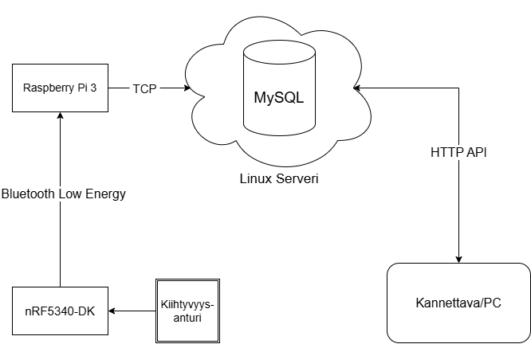

# Tietoliikenteen-sovellusprojekti 2026 
## Projektin tavoitteet ja lyhyt kuvaus
Tarkoituksena on suunnitella client nRF5340 laitteelle, mikä ottaa anturidataa talteen ja välittää tiedon Raspberrylle. Raspberryltä data tulee siirtää tietokantaan koulun virtuaali Linux palvelimelle. Tietokannalle tehdään TCP-socket ja API, jotta dataan päässään käsiksi. Kerätty data sovelletaan koneoppimiseen.
## Toteutus
Projekti seuraa seuraavanlaista arkkitehtuuria: 

<picture></picture>
### Tekijät
 - Teemu Pitkäaho
 - Eemeli Kangas
